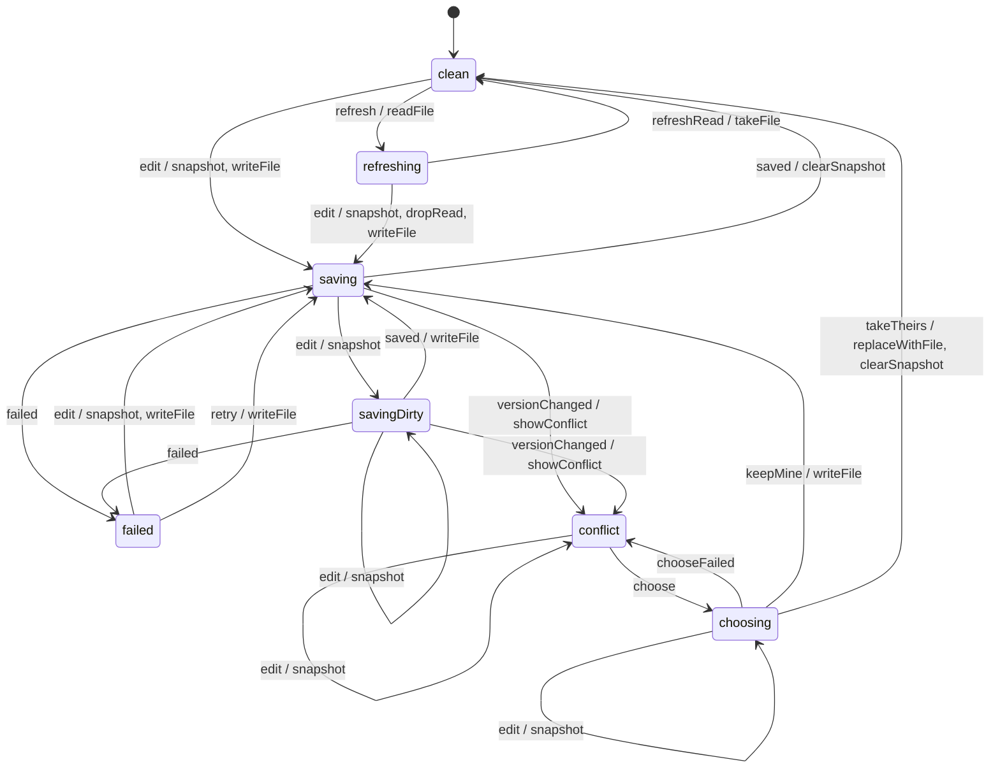

# Architecture

Alarmony is one TypeScript code base with two hosts. The browser and the Electron app run the same UI from one static build; the only thing that differs between them is where `clock.json` comes from.

```
     ┌──────────────── apps/web (Preact + signals, one Vite build) ────────────────┐
     │  App · StopwatchView · TimersView · RingingSheet · CommandMenu · Dialogs      │
     │  AppController (tab, selection, dialogs, notices, ringing) · commands.ts      │
     └──────────────────────────────────────┬───────────────────────────────────────┘
                                            │ imports
     ┌─────────────────── packages/ui (Preact + signals) ───────────────────┐
     │  CommandCatalog · Dialog · ListPopup · icons · SoundPlayer            │
     │  ClockSession (saving, retries, conflicts, recovery)                  │
     │  ClockStore ─┬─ BrowserStore  (the browser's private file system)     │
     │              ├─ NativeStore   (window.alarmonyNative IPC)              │
     │              └─ MemoryStore   (tests, and browsers with no storage)   │
     │  deviceSettings (this device's settings and ringing log)              │
     └──────────────────────────────────────┬───────────────────────────────┘
                                            │
     ┌─────────────────── packages/core (pure TS) ───────────────────┐
     │  format (read, serialize) · ClockDoc (changes, undo) · edits   │
     │  stopwatch and timer arithmetic · durations · ringing · sounds │
     └────────────────────────────────────────────────────────────────┘
     ┌──────────── packages/node-files (Node) ────────────┐
     │  readDataFile · writeDataFile (atomic, versioned)  │◄──── apps/desktop
     └────────────────────────────────────────────────────┘
```

## Layering

- `packages/core` has no DOM and no Node APIs. ESLint rejects `window`, `document`, `localStorage` and `process` there, so the engine runs the same in a browser and in the tests.
- `packages/ui` knows the DOM but not where the file lives: it only sees a `ClockStore`.
- `packages/node-files` is the only code that touches the disk.
- Other packages import only through `@alarmony/<package>`. `test/architecture.test.ts` checks the layers and where page timers, key listeners, storage and dialogs may appear.

## Core (`packages/core`)

- `format.ts`: the file format (PRD §3.2). `classifyFile` reads a file as ok, corrupt, empty or newer, keeping items it can't read so they are written back unchanged; `serialize` writes it pretty-printed.
- `ops.ts` and `clockDoc.ts`: every change is a list of operations, applied as one undo step (PRD §11). An edit that changes nothing records nothing.
- `edits.ts`: the edits the app makes (add, start, pause, edit and delete a timer; presets; the stopwatch).
- `stopwatch.ts`, `timers.ts`, `duration.ts`: the arithmetic and the text for times. Running things store when they started or end, never a count that ticks.
- `ringing.ts`: what is due at a given time, and which of those this device has already rung. `sounds.ts`: the sounds, as notes.

## UI (`packages/ui`)

- `store/`: the `ClockStore` contract and its adapters. A version is the SHA-256 of the file's text; a save sends the version it last saw and fails with `ConflictError` if the file changed (PRD §3.4). `deviceSettings.ts` keeps what each device keeps for itself in page storage: settings, the ringing log and the crash snapshot.
- `session/clockSession.ts`: one open file. It saves every change at once, never two saves at a time, retries a failed save, keeps unsaved text for recovery, and stops on a conflict until the user chooses. What happens when is the table in `session/saveChart.ts`, drawn below.
- `commands/`: the `CommandCatalog`, and the page's one key listener (`keys.ts`).
- `components/`: `Dialog` (modal, focus trap, Escape), `ListPopup` and the `Icon` set. `sound/player.ts` plays the sounds with Web Audio. `schedule.ts` holds every page timer.

### Saving

Every move the save session can make, from `toMermaid()` in `session/saveChart.ts`; a test checks this drawing matches the table. An event with no arrow from the current state changes nothing. To review a change to saving, read this diagram's diff and ask what happens to an edit in each state.



- `snapshot` keeps the data in the recovery slot at every edit, so a crash or a conflict never loses a change.
- `dropRead`: an edit during a refresh wins; the file read is ignored and the save finds any conflict.
- `takeFile` replaces the document with the file and clears undo; `replaceWithFile` (Use Theirs) drops this window's changes.
- `choosing`: a conflict choice is reading the file. The dialog's buttons wait, so a second click can't apply an old read to a later conflict; if the read fails, the dialog is back.

## Web (`apps/web`)

- `main.tsx` picks a store (the native bridge in Electron, else the browser's storage, else memory), opens the session, and drives the controller: a tick every second, a frame loop while the stopwatch runs, and a refresh when the window comes back and every 15 seconds.
- `app/controller.ts`: the app's state as signals, and no timers of its own, so the tests drive it with a clock they move. `tick()` checks what is due and starts or stops ringing (PRD §9).
- `app/commands.ts`: every command. ⌘K, the keys, the toolbar, the native menu bar (`nativeMenu.ts`) and the Keyboard Shortcuts window (`shortcuts.ts`) all read it.

## Desktop (`apps/desktop`)

- `main.ts`: one window, loading the web build from `app://alarmony/`. The renderer is sandboxed with context isolation, IPC is accepted only from that origin, background throttling is off so a hidden window still rings on time, and sound plays without a click. Closing the window hides it; the page keeps running and the menu bar icon (tray) brings it back. While an alarm is on or a timer runs, it holds a power-save blocker against App Nap, and quitting asks first. A wake from sleep tells the page to check what is due.
- `preload.cts` exposes `alarmonyNative`: load, save and save a copy of `clock.json`, set the menu bar and the tray (the page works out what it shows in `app/tray.ts`), open at login, Open Folder…, send menu commands, wake and full-screen changes to the page, and say whether the window uses the unified toolbar (`chrome`; macOS). The channels are listed in `bridge.ts`.
- `paths.ts`: where the data lives, and whether the first start has to ask (`folder.json` remembers the answer). `background.ts`: the tray's menu and the questions you can turn off (`prefs.json`). `dialogs.ts`: every system dialog; a headless run skips them and lists them in `alarmonySkippedDialogs`, and the architecture test allows `dialog.*` nowhere else. `menu.ts`: the menu bar from the catalog plus the standard menus, and the edit menu for right-clicked text. `windowState.ts`: the window's size and place.

## Testing

Vitest runs every package's `test/` folder in Node. The store adapters share one contract test; the engine and the save session have seeded random-operation tests; the web app's tests drive the `AppController` and the catalog against a `MemoryStore` with a clock they move; `controls.test.ts` checks [Controls](controls.md) against the catalog. Playwright runs the scenarios in `e2e/` in headless Chromium, and the desktop smoke test starts Electron headless on a throwaway folder.
